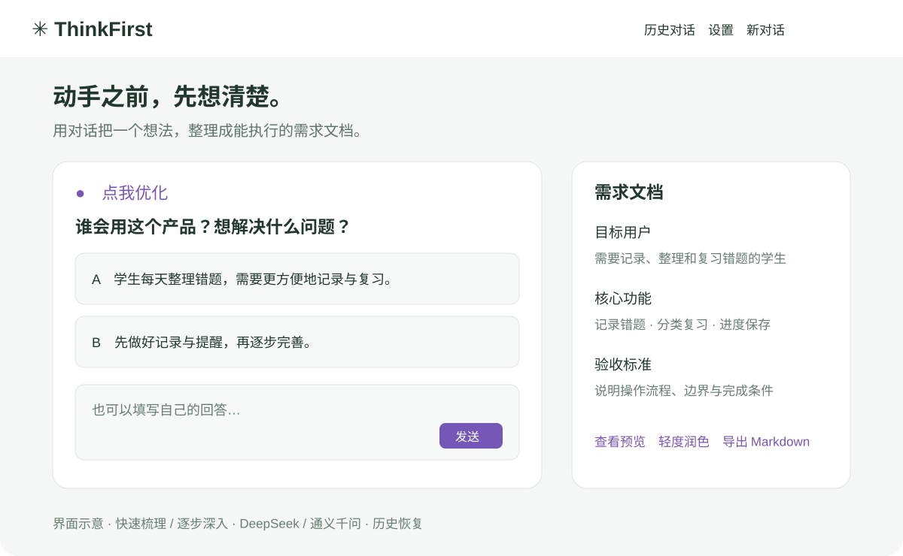

# ThinkFirst

> 动手之前，先想清楚。



ThinkFirst 是一个通过 Agent 对话梳理需求的 Web 项目。用户选择卡片或填写回答，逐步明确目标用户、问题、功能范围、风险与验收条件，最后生成可预览、修改和导出的需求文档（PRD）。上图为功能界面示意，并非运行截图。

## 可以做什么

- **两种引导方式**：快速梳理按 5 组推进；逐步深入按 12 步展开。可以回退修改，不能向前跳过。
- **动态选项与编辑**：结合用户回答生成候选，确认卡可直接编辑；点击紫色小人可对照文档预览优化章节。
- **多厂商模型**：支持 DeepSeek 和通义千问北京、新加坡入口，密钥按账号加密保存；已配置接口可作为备用。
- **历史恢复**：会话、回答和文档版本保存到数据库，未完成或已完成的对话都可以继续。
- **文档交付**：支持轻度润色后导出 Markdown，也能调整为公司详细版、Codex 或 Claude Code 开发提示词。
- **安全与容错**：密码哈希、API Key 加密、接口鉴权、请求限流、超时与模型返回格式校验。

## 技术结构

| 部分 | 技术与职责 |
|---|---|
| 前端 | Vue 3、Vite、Vue Router：卡片交互、历史记录和文档预览 |
| 后端 | Java 17、Spring Boot 3：认证、会话流程、模型调用和导出 |
| 数据库 | 本地默认 H2 文件数据库；生产配置支持 MySQL |
| 模型接入 | OpenAI 兼容接口、按用户密钥调用、可用接口切换 |
| 知识检索 | 中文关键词与向量混合检索，辅助需求引导 |

```text
ThinkFirst/
├── app/                  # 前端与检索语料
├── server/               # 后端、数据库和测试
├── docs/
│   ├── images/           # README 项目图片
│   └── teaching/         # 项目解析教学文档入口
└── README.md
```

## 本地运行

需要 Node.js 20+、Java 17 和 Maven。以下命令分别在两个终端运行。

```bash
cd server
mvn spring-boot:run
```

```bash
cd app
npm install
npm run dev
```

访问 `http://localhost:5173/ThinkFirst/`，注册后在设置里选择厂商并填写对应 API Key。千问密钥需与选择的地域一致。实际模型调用由相应厂商计费。

## 构建与测试

```bash
cd server
mvn test
mvn package
```

```bash
cd app
npm run build
```

## 项目解析与教学

后续教学将从前端交互、接口请求、状态推进、模型调用、持久化、安全和部署逐步拆解，适合有基础语法知识的初学者。章节规划见 [教学文档入口](docs/teaching/README.md)。

相关说明：[后端运行与部署](server/README.md) · [项目架构](docs/architecture.md) · [模型与导出配置](docs/模型与导出配置.md)。

## 部署注意

- 云端需要同时部署前端和后端；只更新网页不能获得新的模型接口。
- 生产环境使用 HTTPS，并配置独立的 `TF_JWT_SECRET` 和 `TF_MASTER_KEY`。加密主密钥必须与数据库一起妥善备份，不可随意更换。
- 不要提交真实密码、API Key、服务器凭据、数据库、日志或本地部署文件。
- 模型结果需要用户确认，系统不会把 AI 推测视为已完成的用户调研。
